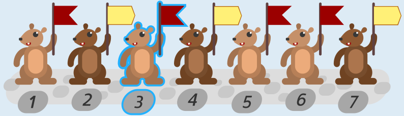
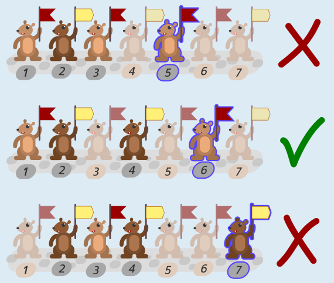

Biber Nummer **3** hält die falsche Flagge hoch.

Einen Prüf-Biber und seine Nachrichten-Biber wollen wir als Gruppe bezeichnen und geben ihr die Nummer des Prüf-Bibers. Es gibt also die drei Gruppen 5, 6 und 7. Eine Gruppe soll also eine gerade Anzahl an roten Flaggen hochhalten. Hier sind die Gruppen, der Prüf-Biber der Gruppe ist markiert.

Man sieht: Bei Gruppe 5 gibt es einen Fehler, sie hält drei rote Flaggen hoch. Bei Gruppe 6 ist alles in Ordnung (zwei rote Flaggen), aber bei Gruppe 7 gibt es auch einen Fehler, sie hält nur eine rote Flagge hoch.

Die Biber aus Gruppe 6, also die Biber 1, 2, 4 und 6, machen alles richtig. In Gruppe 5 könnte also entweder Biber 3 oder Biber 5 die falsche Flagge hochhalten. In Gruppe 7 könnte entweder Biber 3 oder Biber 7 die falsche Flagge hochhalten. Da insgesamt nur genau ein Biber die falsche Flagge hochhält, muss der gleiche Biber für die Fehler in den Gruppen 5 und 7 verantwortlich sein. Das kann nur Biber 3 sein.

## Das ist Informatik!

In der digitalen Welt werden Nachrichten und auch andere Daten binär codiert, also als Folgen aus Bits (0 und 1), und so über Kommunikationskanäle übertragen, ob über Leitungen oder drahtlos. Dabei kann es zu Störungen kommen, welche die Bits vertauschen: aus 0 wird 1 oder umgekehrt. Für eine korrekte Informationsverarbeitung möchte man feststellen, ob eine Übertragung von einer Störung betroffen war, und die entstandenen Fehler korrigieren. Dazu wurden *fehlerkorrigierende Codes* entwickelt.

Eine einfache Möglichkeit wäre, jedes Bit dreimal hintereinander zu senden. Eine Störung an einem der drei Bits könnte leicht erkannt und korrigiert werden, denn die zwei anderen Bits tragen noch immer die richtige Information; die Mehrheit entscheidet dann. Dieses einfache Verfahren führt aber dazu, dass drei mal so viele Daten übertragen werden müssen. Damit die Datenleitungen nicht verstopfen, ist es wichtig, möglichst wenige zusätzliche Bits zur Fehlerkorrektur zu verwenden.

Der Biber-Boss setzt einen *Hamming-Code* ein. In einem Hamming-Code gibt es für mehrere Gruppen der eigentlichen Datenbits jeweils ein Prüfbit. Das Prüfbit wird so aus den Datenbits der passenden Gruppe berechnet, dass Datenbits und Prüfbit zusammen eine gerade Anzahl von 1en enthalten; diese Eigenschaft nennt man auch „gerade Parität“. Wenn in einer Nachricht für alle Gruppen aus Datenbits und zugehörigem Prüfbit die Parität stimmt, dann kann man annehmen, dass die Nachricht richtig übertragen wurde. Wurde nur ein Bit einer mit Hamming-Code kodierten Nachricht durch eine Störung verändert, lässt sich das gestörte Bit und die Originalnachricht korrekt bestimmen, indem man schaut, bei welchen Gruppen die Parität nicht stimmt.

Mit drei Prüfbits kontrolliert der Hamming-Code vier Datenbits, wie in dieser Biberaufgabe. Mit vier Prüfbits können schon 11 Datenbits kontrolliert werden, das Codewort ist dann 15 Bits lang. Mit *k* Prüfbits kann das Codewort 2*k* – 1 Bits lang sein. Für lange Codewörter werden also nur wenige zusätzliche Bits benötigt. Dass man mit Hilfe des Hamming-Codes nur einen Bitfehler pro Codewort korrigieren kann, ist in vielen Fällen gut genug. In der Informatik sind Codes bekannt, mit deren Hilfe man auch mehrere Fehler korrigieren kann.
