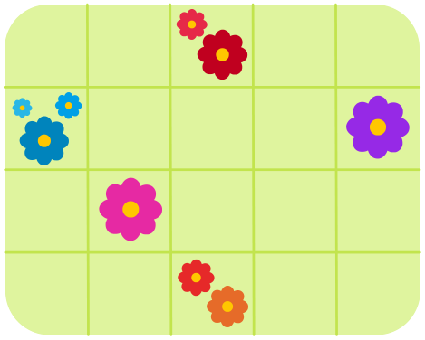

Unten siehst du Bobs Garten. Der Garten ist in Felder eingeteilt. In einigen Feldern sind Blumen (im Raster rosa gefärbt, fest vorgegeben).

Bob möchte die Blumen mit Rasensprengern gießen. Ein Sprenger kann nur auf ein leeres Feld gestellt werden. Er gießt dann die 8 Felder rundherum.

Wähle im Raster die blaue Farbe und tippe die Felder an, auf die du Sprenger stellen willst. Die Felder mit den Blumen sind rosa.

**Stelle Sprenger im Garten auf, die alle Blumen gießen. Benutze so wenige Sprenger wie möglich!**
