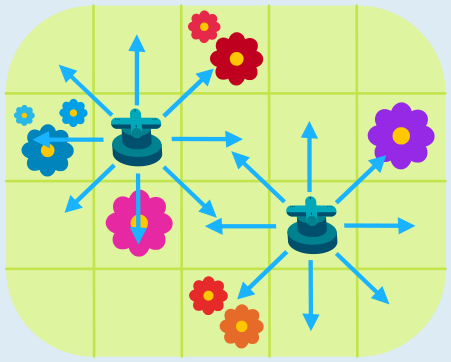

---
answers:
  - [[0, 0, 2, 0, 0], [2, 1, 0, 0, 2], [0, 2, 0, 1, 0], [0, 0, 2, 0, 0]]
---
Man kann zwei Rasensprenger aufstellen und damit alle Blumen gießen:

Ein Rasensprenger muss rechts, links oder schräg neben einer Blume stehen, um sie zu gießen. Ein einzelner Sprenger kann nicht gleichzeitig neben allen Blumen in Bobs Garten stehen, zum Beispiel nicht neben den Blumen ganz links und der Blume ganz rechts. Deshalb muss man mindestens zwei Sprenger aufstellen, und zwar genau so wie im Bild.

## Das ist Informatik!

Diese Biberaufgabe stellt uns vor ein *Optimierungsproblem*: Alle Blumenfelder sollen bewässert werden, aber die Anzahl der benötigten Rasensprenger soll möglichst klein sein. Möglichst klein ist hier „optimal“, also am besten – zum Beispiel für das Bankkonto der Person, welche die Sprenger bezahlen muss. (Siehe auch die Aufgabe „Blumenkasten“ in diesem Biberheft.)

Durch das Aufstellen der Sprenger teilen wir die Menge der Blumen auf: Die Blumen, die vom selben Sprenger gegossen werden, gehören zum selben Teil. Mit mehr Sprengern könnten wir mehr Teile bilden, aber es soll ja eine beste Aufteilung mit möglichst wenig Sprengern sein. Eine solche Aufteilung heißt in der Informatik auch Partitionierung.

Beste bzw. optimale Aufteilungen kann man in vielen Situationen gebrauchen, etwa wenn man mit möglichst wenigen Hotspots alle Räume einer Schule mit gutem WLAN versorgen möchte. Gibt es viele Räume (oder viele Blumenfelder), kann die Suche nach einer besten Aufteilung ein sehr schwieriges Problem sein. Daher ist man häufig schon zufrieden, wenn man eine Aufteilung findet, die vielleicht nicht optimal ist, aber fast. Bräuchte man für die beste Aufteilung theoretisch 100 Hotspots, ist eine Aufteilung mit 105 Hotspots ziemlich gut, wenn es zu schwierig ist, die beste zu finden.
