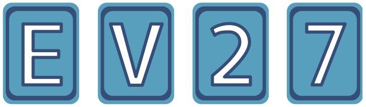

Dein Freund Aristo hat Spielkarten mitgebracht. Auf der einen Seite jeder Karte ist ein Buchstabe und auf der anderen Seite ist eine Zahl. Aristo behauptet: Wenn auf der einen Seite einer Karte ein Vokal ist, dann ist auf der anderen Seite eine gerade Zahl.

Aristo legt vier Karten vor dich hin. Du weißt, dass E ein Vokal, V ein Konsonant, 2 gerade und 7 ungerade sind. Aber weißt du auch, ob Aristo die Wahrheit gesagt hat? Du willst seine Behauptung sicher überprüfen.

**Welche Karten musst du dazu unbedingt umdrehen?**
