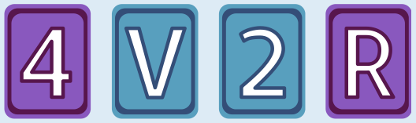

Die Karten **E** und **7** müssen umgedreht werden.

Die E-Karte muss umgedreht werden, um zu prüfen, ob auf der Rückseite eine gerade Zahl ist. Wäre sie ungerade, hätte Aristo die Unwahrheit gesagt.

Die V-Karte muss nicht umgedreht werden. Über Konsonanten hat Aristo nichts gesagt, also keine Wahrheit und auch keine Unwahrheit.

Die 2-Karte muss nicht umgedreht werden. Falls auf der Rückseite ein Konsonant wäre, hätte Aristo keine Unwahrheit gesagt. Falls dort ein Vokal wäre, hätte er die Wahrheit gesagt.

Die 7-Karte muss umgedreht werden. Wäre auf der Rückseite ein Vokal, hätte Aristo die Unwahrheit gesagt.

## Das ist Informatik!

Es ist gar nicht schwer, einen Computer denken zu lassen. Vor allem, wenn es um das Denken in klassisch-logischen Implikationen geht. Einige Programmiersprachen bieten dazu als Basis das Konstrukt (IF a THEN b) an. Das ist nicht die berühmte „if-Anweisung“ oder „bedingte Anweisung“, sondern ein Ausdruck mit logischem Wert, der die beiden Ausdrücke a und b zu „wenn a, dann b“ verbindet. Der Ausdruck ist genau dann „falsch“, wenn a den Wert „wahr“ und b den Wert „falsch“ hat; sonst ist der Ausdruck „wahr“.

In dieser Biberaufgabe gibt es auch ein (IF a THEN b): a ist die Aussage „auf einer Seite ist ein Vokal“, und b ist die Aussage „auf der anderen Seite ist eine gerade Zahl“. (IF a THEN b) kann also falsch sein, wenn auf der sichtbaren Seite wirklich ein Vokal ist (a ist „wahr“) oder eine ungerade Zahl ist (b ist „falsch“). Deshalb mussten die Karten mit E und 7 umgedreht werden, um die Wahrheit des gesamten Ausdrucks zu überprüfen.

In Programmiersprachen mit (IF a THEN b) kann man sogar einen weit verbreiteten menschlichen logischen Denkfehler programmieren:

(IF (IF a THEN b) THEN (IF b THEN a))

Dieser Ausdruck ist nicht immer „wahr“, sondern ist „falsch“, wenn a „falsch“ und b „wahr“ ist.
