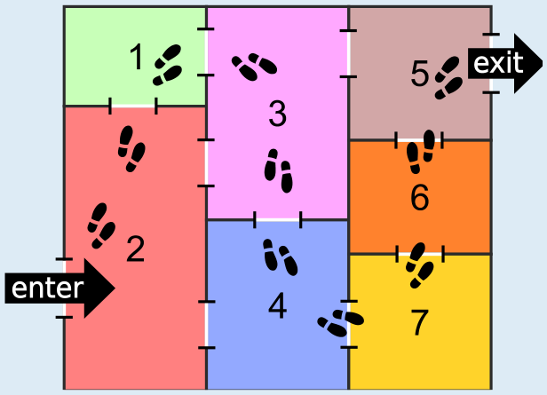
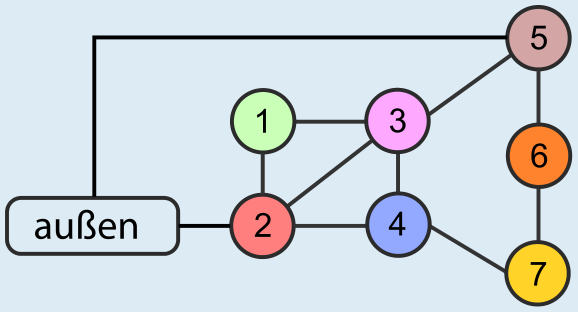

Nur der Plan C erlaubt den Besuchern, einen Rundgang zu machen, und zwar so:

Falls ein Raum nur einen Eingang hat, kann man keinen Rundgang nach den vorgegebenen Regeln machen: Wenn eine Besucherin diesen Raum betritt, kann sie ihn nur durch den einen Eingang auch wieder verlassen. So kommt sie zurück in den Raum, aus dem sie gekommen ist, und betritt diesen zum zweiten Mal. Damit ist die Rundgang-Regel verletzt.

Deshalb erlauben die Pläne A und D keinen Rundgang. In Plan A hat Raum 1 nur einen Eingang, und in Plan D hat Raum 6 nur einen Eingang.

In Plan B kann der Raum 6 von Raum 5 oder von Raum 7 erreicht werden. Falls die Besucherin von Raum 5 kommt, muss sie Raum 6 durchqueren, um den Raum 7 zu betreten (und umgekehrt). Dann kann sie den Ausgang nur noch erreichen, indem sie Raum 6 zum zweiten Mal betritt.

## Das ist Informatik!

Auch wenn das Museum nicht sehr groß ist, muss man genau hinsehen, wo man lang geht, um die möglichen Wege zu prüfen. Dabei sind die Größe der Räume und deren genaue Lage für die Frage nach einem Rundgang unerheblich. Man muss nur wissen, von welchem Raum man in welche anderen Räume gelangen kann und wo die Verbindungen nach außen sind. Das können wir für Plan C so aufzeichnen:

Damit haben wir den Plan auf das Wesentliche reduziert – und ihn als Graphen modelliert (siehe auch die Aufgabe „Geschäfte“ in diesem Biberheft). Ein Graph ist eine mathematische Struktur aus Knoten und Kanten: Hier entsprechen die Räume (einschließlich des Raums „außen“) den Knoten und die Türen den Kanten. Ein Rundgang ist dann ein Weg über Kanten des Graphen, bei dem alle Knoten genau einmal besucht werden, bis man beim ersten Knoten („außen“) wieder ankommt.

In der Welt der Graphen nennt man einen solchen Weg einen Hamiltonkreis. Das Hamiltonkreis-Problem, also die Entscheidung darüber, ob es in einem Graph einen Hamiltonkreis gibt, ist eines der berühmten NP-vollständigen Probleme und damit im Allgemeinen eines der schwierigsten Probleme, die die Informatik kennt. Wenn der Graph so übersichtlich ist wie bei den Museumsplänen dieser Biberaufgabe, ist das Hamiltonkreis-Problem aber nicht so schwer zu lösen. Generell lässt sich die Informatik von einem schwierigen Problem nicht beeindrucken. Sie sucht dann unter anderem nach Spezialfällen, für die man das Problem doch gut lösen kann. Für das Hamiltonkreis-Problem sind einige bekannt.
