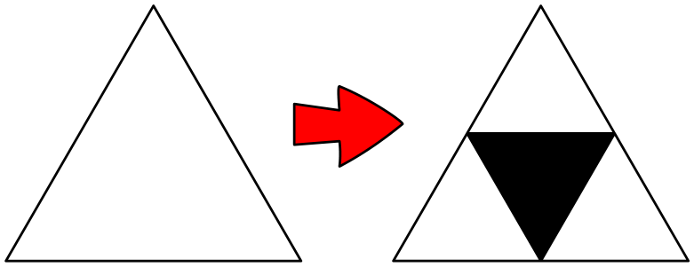

Ein Sierpinski-Dreieck zeichnet man so: Zuerst zeichnet man ein gleichseitiges weißes Dreieck. Dann geht es schrittweise weiter.

In jedem Schritt wird jedes weiße Dreieck in vier kleinere unterteilt und das mittlere davon schwarz gefärbt:

Für den ersten Schritt ist das schon erledigt.

**Wie sieht ein Sierpinski-Dreieck nach drei Schritten aus?** Färbe die richtigen Teildreiecke schwarz.
