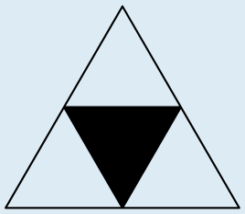
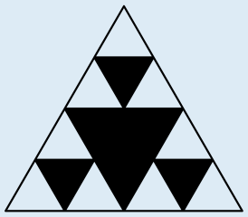
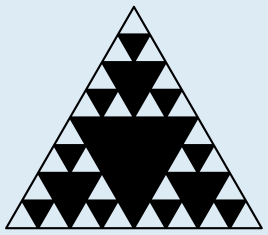

Im ersten Schritt wird das ursprüngliche weiße Dreieck unterteilt. Das mittlere der vier bei der Unterteilung entstandenen kleineren Dreiecke wird schwarz gefärbt. Danach gibt es drei weiße Dreiecke.

Im zweiten Schritt werden die drei weißen Dreiecke unterteilt, und jeweils das mittlere (noch kleinere) Dreieck schwarz gefärbt. Jetzt gibt es neun weiße Dreiecke.

Im dritten Schritt werden nun die neun weißen Dreiecke unterteilt, mit einem schwarzen Teildreieck in der Mitte:

So sieht ein Sierpinski-Dreieck nach drei Schritten aus. Die Teildreiecke müssen also genau so gefärbt werden. (Insgesamt sind es 3 mittlere Dreiecke aus je 4 kleinen Teildreiecken und 9 kleine Teildreiecke.)

## Das ist Informatik!

Das Sierpiński-Dreieck gehört zu den Fraktalen, einer besonderen Art geometrischer Objekte, und wurde zuerst vom polnischen Mathematiker Wacław Franciszek Sierpiński (1882–1969) im Jahr 1915 beschrieben. Die Konstruktion des Sierpiński-Dreiecks ist rekursiv (vom Lateinischen recurrere: zurücklaufen). Dies bedeutet, dass eine bestimmte Abfolge von Anweisungen (hier: das Teilen und Einfärben eines Dreiecks) mit den neu entstandenen Objekten wiederholt ausgeführt wird (der sogenannte Rekursionsschritt), bis eine bestimmte Abbruchbedingung erfüllt ist (zum Beispiel, wie oft die Dreiecke geteilt werden). Eine rekursive Definition erlaubt eine sehr knappe Beschreibung von recht komplexen Objekten (siehe auch die Aufgaben „Digitale Bäume“ und „Zahlenmaschine“ in diesem Biberheft).

Das Sierpiński-Dreieck und andere Fraktale wie die Koch-Schneeflocke oder die Mandelbrot-Menge wurden im 20. Jahrhundert in der Informatik intensiv untersucht, insbesondere seit es möglich wurde, Computer einzusetzen, um die einzelnen Rekursionsschritte automatisch zu berechnen.
