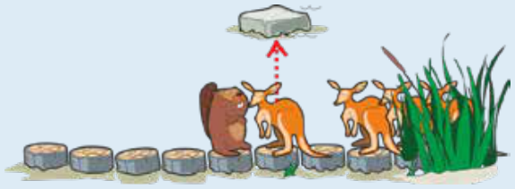
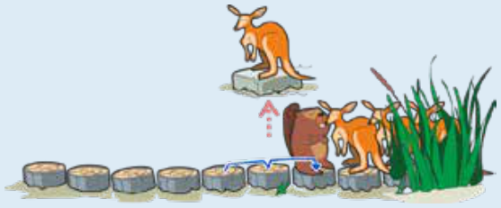
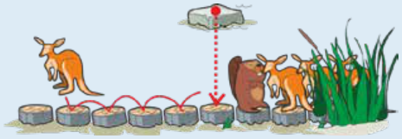
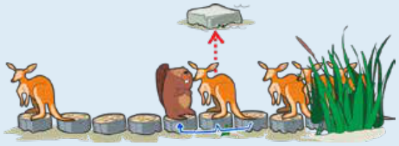

Antwort C ist richtig: Fred kann höchstens genau 6 Kängurus vorbei lassen.

So kann Fred genau ein Känguru vorbei lassen:

Das Känguru springt auf den Stein.

Fred geht zwei Baumstümpfe vorwärts.

Das Känguru springt zurück und setzt seinen Weg fort.

Fred geht zweimal einen Baumstumpf zurück. Dann ist er wieder auf der Ausgangsposition und kann das Verfahren wiederholen, um jeweils ein weiteres Känguru vorbei zu lassen.

Da Fred höchstens 10-mal einen Baumstumpf zurück gehen will, kann er nach dem ersten Känguru höchstens 5 weitere Kängurus vorbei lassen, insgesamt also genau 6 Kängurus.

## Das ist Informatik!

Die Lösung zu dieser Biberaufgabe haben wir oben als Algorithmus beschrieben: als Folge einfacher, klarer Anweisungen, die nach und nach ausgeführt werden, zum Beispiel „Fred geht zwei Baumstümpfe vorwärts“ oder „das Känguru springt auf den Stein“. Außerdem gibt es eine Wiederholungsanweisung, also die Anweisung, eine Folge anderer Anweisungen mehrfach auszuführen.

Mit Wiederholungsanweisungen, in der Informatik auch als *Schleifen* bezeichnet, können gleichförmige Aufgaben zuverlässig mehrfach erledigt werden. Dabei ist es in der Regel von Vorteil, bei jedem Schleifendurchlauf, also bei jeder Ausführung der zu wiederholenden Anweisungen, die gleiche Situation herzustellen – die sogenannte *Schleifeninvariante*. In dieser Biberaufgabe muss Fred jedes Mal auf seine Ausgangsposition zurück, damit die zu wiederholenden Anweisungen auch für das nächste Känguru wieder funktionieren.

Ein Algorithmus ist der Kern jedes Computersystems, denn Computer können nur nach klaren Anweisungen arbeiten. In der Informatik sind für sehr viele Probleme Algorithmen bekannt und entwickelt worden, mit deren Hilfe Computer diese Probleme lösen können.
