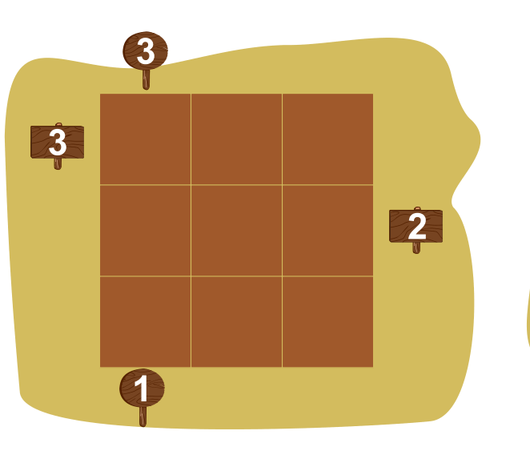

Die Biber möchten Tannen auf ein Feld setzen. Die Tannen haben drei unterschiedliche Höhen (klein, mittel und groß). Wenn eine Tanne hinter einer größeren Tanne steht, kann man sie nicht sehen.

Das Feld hat Reihen mit je 3 Plätzen für Tannen: Drei Reihen waagerecht (von links nach rechts), drei Reihen senkrecht (von oben nach unten).

Am Ende einer Reihe steht manchmal ein Schild. Darauf steht, wie viele Tannen in dieser Reihe man vom Schild aus sehen soll. Die Tannen müssen so gesetzt werden, dass alle Schilder stimmen. Und: In jeder Reihe (waagerecht und senkrecht) müssen alle Tannenhöhen vorkommen.

Hier ist ein Beispiel mit einer Reihe. Alle Tannen stehen richtig.

Setze alle Tannen auf das Feld. Am Ende müssen alle Tannen richtig stehen.

Im Raster stehen die Farben von links nach rechts für: leerer Platz (weiß), kleine Tanne (hellgrün), mittlere Tanne (grün), große Tanne (dunkelgrün).

**Setze alle Tannen auf das Feld.**
