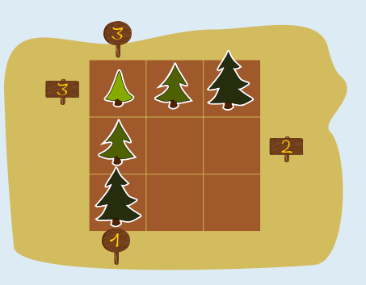
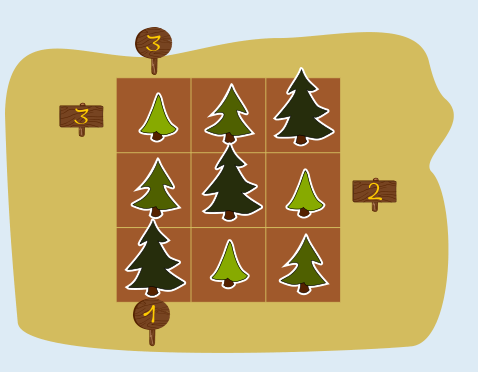

Die beiden Schilder mit der 3 sagen, dass man drei Tannen sehen soll

- von links in der oberen waagerechten Reihe und
- von „oben“ in der linken senkrechten Reihe.

Alle drei Tannen einer Reihe kann man nur sehen, wenn die Höhe der Tannen vom Schild aus gesehen ansteigt: klein, mittel, groß.

Die Tannen müssen also so auf die beiden Reihen gesetzt werden (und damit ist auch die Bedingung des Schildes unten links erfüllt):

Das Schild rechts mit der 2 sagt, dass von dort zwei Tannen sichtbar sind. Das geht nur, wenn die kleine Tanne auf den Platz beim Schild und die große Tanne dahinter gesetzt wird.

Die letzten beiden Plätze werden mit Hilfe der „Sudoku-Regel“ gefüllt, dass in jeder Reihe alle Tannenhöhen vorkommen müssen. So stehen alle Tannen richtig:

## Das ist Informatik!

Wer hätte das gedacht? Vier „Sichtbarkeits-Zahlen“ und die Tannen-Sudoku-Regel in dieser Biberaufgabe genügen, um die Anordnung von neun Tannen auf dem Feld eindeutig zu bestimmen. Auch bei üblichen Sudoku-Rätseln kann die Platzierung von nur wenigen Zahlen genügen, damit ein Rätsel eindeutig gelöst werden kann. Daten (wie die Befüllung der 81 Plätze eines Sudoku-Rätsels mit Zahlen) können oft stark reduziert werden, ohne die in den Daten enthaltene Information zu verlieren. In der Informatik spricht man dann davon, dass Daten verdichtet oder komprimiert werden. Das geht meist nur, wenn man Regeln oder Gesetzmäßigkeiten ausnutzen kann, die für bestimmte Datenarten gelten – wie die Tannen-Sudoku-Regel für das Tannenfeld. Bei der Komprimierung (oder auch: Kompression) von Bilddaten kann man zum Beispiel ausnutzen, dass die meisten Bilder bestimmte Farbmuster mehrfach enthalten.

Kompression ist das tägliche Brot von Computersystemen und wird deshalb in der Informatik sehr gründlich erforscht. Ohne Kompression würden viel weniger Fotos, Songs oder Videos in den Speicher eines Smartphones oder auf die Festplatte eines Computers passen, als wir das gewohnt sind.
