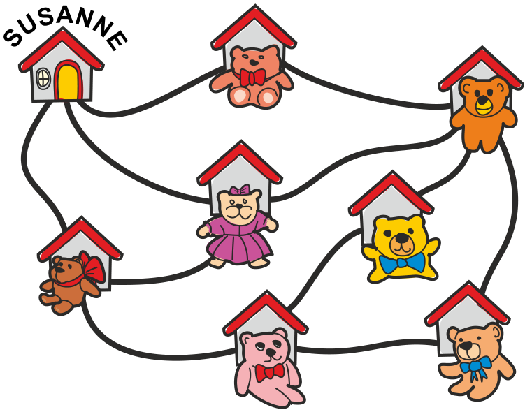
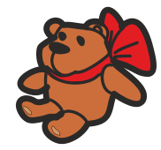
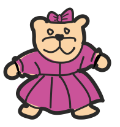
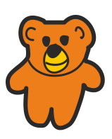

In Susannes Dorf sitzt vor jedem Haus ein Teddybär.

Susanne geht spazieren. Sie geht zu Hause los, dann an vier anderen Häusern vorbei und zurück nach Hause. Susanne hat also vier Teddys gesehen. Sie erinnert sich aber nur an diese drei:

  

**Welchen Teddybären hat Susanne noch gesehen?**
