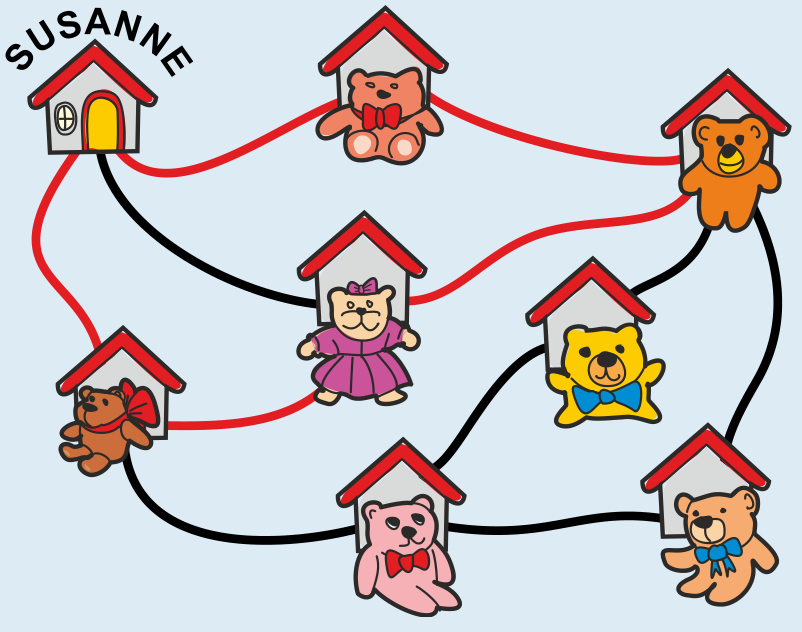

Antwort C ist richtig:

Susanne macht einen Rundgang: Sie geht zu Hause los und kommt am Ende nach Hause zurück. Susanne kann viele verschiedene Rundgänge durch ihr Dorf machen. Der kürzeste Rundgang führt Susanne an nur zwei Häusern vorbei. Mehrere Rundgänge führen sie an mehr als vier Häusern vorbei. Aber es gibt nur einen Rundgang mit genau vier Häusern:

Auf diesem Rundgang geht es an den drei Teddybären vorbei, an die Susanne sich erinnert. Außerdem geht es beim lachsroten Teddybär (Antwort C) vorbei. Den hat Susanne also auch noch gesehen.

## Das ist Informatik!

Susanne ist ein Fehler passiert: Sie hat einen Teddy nicht „gespeichert“. Jetzt gibt es eine Lücke in der Information über ihre Erinnerung. In dieser Biberaufgabe können wir die Lücke schließen, weil wir zusätzliche Information haben: Wir wissen, wo die Teddys sitzen und dass Susanne einen Rundweg an vier Häusern entlang gemacht hat. Das ist ähnlich wie bei Lückentexten aus dem Deutschunterricht oder Mathematikaufgaben mit leeren Feldern. Weil wir die Deutsch-Regeln kennen oder wissen, wie man richtig rechnet, können wir auch dort die Lücken füllen.

Auch in der Informatik kommen Fehler und Lücken vor. Beim Übertragen oder Speichern von Daten können Fehler passieren. Aber es ist wichtig, dass die von Computern gespeicherten Daten stimmen. Deshalb wurden in der Informatik Methoden entwickelt, diese Fehler zu erkennen und zu korrigieren. Wenn der Fehler nicht zu groß ist, kann man das schaffen, indem man zusätzliche Information überträgt oder speichert – so wie in dieser Biberaufgabe.
