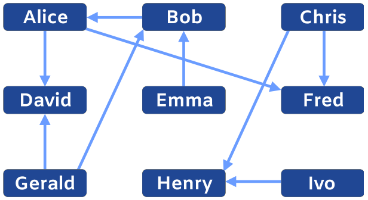

In einem Freiluft-Sportturnier wurden schon einige Partien gespielt. Im Bild unten zeigen die Pfeile, wer dabei gegen wen gewonnen hat. Zum Beispiel hat Bob gegen Alice gewonnen und Alice gegen David.

Leider wird das Wetter schlecht. Um die Anzahl der noch nötigen Partien zu verringern, wird eine neue Regel aufgestellt: Es soll derjenige Turniersieger werden, der besser ist als alle anderen.

Wenn A gegen B gewonnen hat, dann gilt:

- A ist besser als B.
- Wenn B besser ist als einige andere Spieler, ist auch A besser als diese Spieler.

Jetzt sollen nur noch die Spieler weitermachen, die nach der neuen Regel noch Turniersieger werden können.

**Welche Spieler können noch Turniersieger werden?** Wähle alle richtigen Namen aus.
