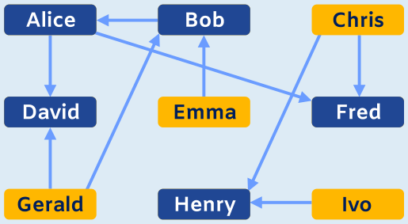

Jeder Spieler (oder jede Spielerin), für die es keinen anderen Spieler gibt, der besser ist, kann selbst am Ende noch besser sein als alle anderen – und noch Turniersieger werden. Für alle Spieler, die schon einmal verloren haben, gibt es (mindestens) einen besseren Spieler. Deshalb können noch alle Spieler Turniersieger werden, die bisher noch kein Spiel verloren haben. Also müssen im Bild alle Namen angeklickt werden, auf die kein Pfeil zeigt: Chris, Emma, Gerald und Ivo.

## Das ist Informatik!

In dieser Biberaufgabe stellt sich das Problem, anhand einer Reihe von Vergleichen („besser als“) eine Sortierung aufzustellen: Es sind die Spieler zu bestimmen, die nach aktuellem Stand die Besten sind – bzw. für die es keine besseren Spieler gibt. Wir begegnen diesem Problem auch bei der Aufgabe „Am schwersten“ in diesem Biberheft, und in der Informatik ist es als „topologische Sortierung“ bekannt. Wenn nicht alle zu sortierenden Dinge miteinander verglichen wurden, kann es mehrere Sortierungen geben – so wie in dieser Biberaufgabe mehrere Spieler nach aktuellem Stand die Besten sind. Beim Sortieren hilft, wenn die Vergleiche „transitiv“ sind, so wie es in dieser Aufgabe die neue Regel festlegt: Wenn A besser ist als B und B besser als C, dann ist A auch besser als C. So ergeben sich aus direkten Vergleichen weitere, indirekte Vergleiche, und die Anzahl der möglichen Sortierungen sinkt. Topologische Sortierung kann einem auch im Alltag begegnen, etwa wenn es Dinge gibt, die in ihrer Reihenfolge voneinander abhängen: Wer sich Socken und Schuhe anziehen will, sollte die Socken vor den Schuhen anziehen; das Hemd ist vor der Jacke an der Reihe; und wenn das T-Shirt vor dem Hemd drankommt, ist es transitiv auch vor der Jacke dran. Ob aber die Socken oder das T-Shirt zuerst angezogen werden, ist egal; es sind also mehrere Sortierungen möglich.
