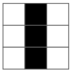
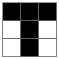
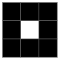
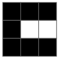
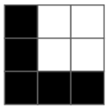
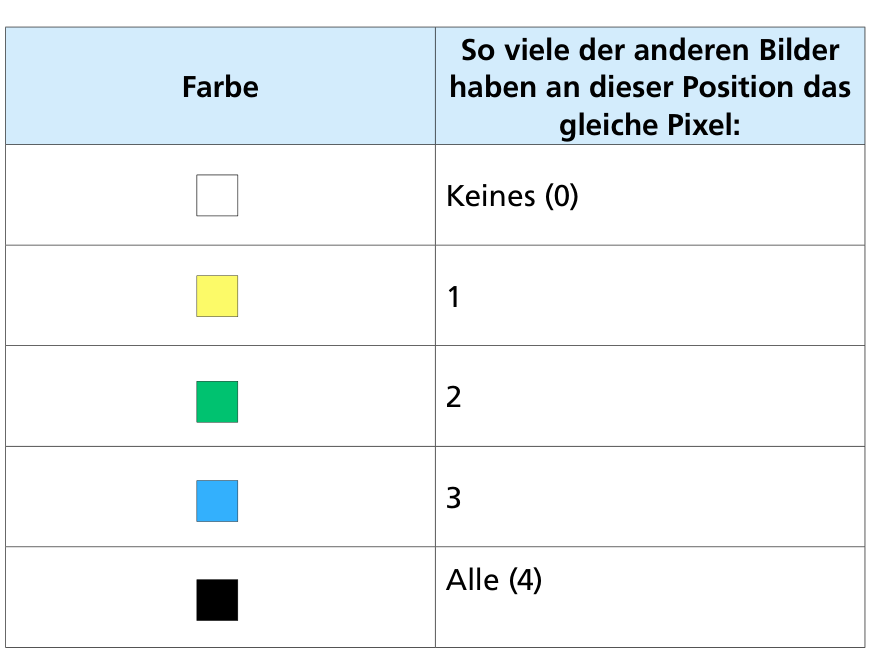
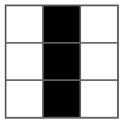
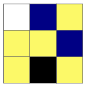
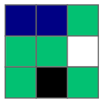

Eine Maschine erkennt genau diese Pixel-Bilder, und zwar als Buchstaben I, T, O, C und L:

    

Dabei entsteht für jedes der fünf Bilder eine Unterscheidungskarte. Die Unterscheidungskarte zeigt für jedes Bild-Pixel an dessen Position eine Farbe. Die Farbe zeigt, wie viele der anderen Bilder an dieser Position das gleiche Pixel haben. Je heller die Farbe, desto wichtiger ist dieses Pixel für die Unterscheidung:

Ein Beispiel: Das Pixel-Bild  hat diese Unterscheidungskarte: 

Welches Pixel-Bild hat diese Unterscheidungskarte:  ?

**Welches Pixel-Bild hat diese Unterscheidungskarte?**
