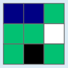
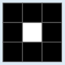
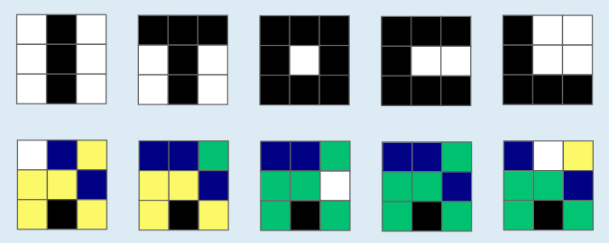

Antwort B ist richtig:

Die Unterscheidungskarte  zeigt in Reihe 2, Spalte 3 die Farbe Weiß. Das zugehörige Bild muss sich also in diesem Pixel von allen anderen Bildern unterscheiden.

Beim Bild aus Antwort B  ist dieses Pixel schwarz, bei allen anderen Bildern ist es weiß. Nur Bild B unterscheidet sich also in diesem Pixel von allen anderen Bildern.

Hier sind noch einmal alle Bilder, mit ihren Unterscheidungskarten darunter.

## Das ist Informatik!

Die Unterscheidungskarten in dieser Biberaufgabe zeigen Werte als Farben an. Damit funktionieren sie so ähnlich wie die Temperaturkarten bei der Wettervorhersage: Dort wird der für einen Ort vorhergesagte Temperaturwert mit einer Farbe kodiert, häufig von Blau für niedrige Temperaturen bis Violett für (sehr) hohe Temperaturen. Mit Hilfe der Temperaturkarten (engl. „heat maps“) werden warme oder kalte Regionen gut erkennbar.

Aber auch viele andere Arten von Daten können als „heat map“, also mit Hilfe einer Farbkodierung, sehr gut veranschaulicht werden, insbesondere wenn die Daten eine räumliche Zuordnung haben. In künstlichen neuronalen Netzen, die in der Informatik häufig als Kernmodul lernender Systeme verwendet werden, kann der Zustand der vielen aktiven Einheiten (der „Neuronen“) auch als heat map dargestellt werden. Dazu werden die Aktivierungswerte der Neuronen in einer Matrix angeordnet, bekommen also eine zweidimensionale räumliche Zuordnung. Je nach Kodierung können die Farben anzeigen, wie wichtig die einzelnen Neuronen für die Erkennung bestimmter Objekte sind – genau wie bei den Unterscheidungskarten.
