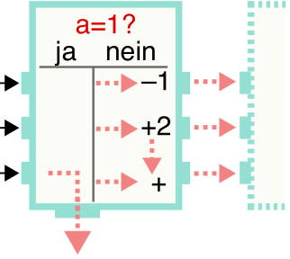
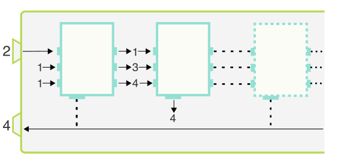

Die mysteriöse Zahlenmaschine erhält eine Zahl als Eingabe und gibt eine andere Zahl aus.

Im Inneren der Maschine arbeiten Einheiten. Jede Einheit erhält drei Zahlen a, b, c als Eingabe und arbeitet nach diesen Anweisungen:

- Wenn a eine 1 ist, gib c an die Zahlenmaschine als Ausgabe weiter.
- Sonst mache Folgendes:
  - Gib a−1 als Eingabe a an die nächste Einheit weiter.
  - Gib B = b+2 als Eingabe b an die nächste Einheit weiter.
  - Gib B+c als Eingabe c an die nächste Einheit weiter.

Die Zahlenmaschine gibt ihre Eingabezahl als Eingabe a an die erste Einheit weiter. Die Eingaben b und c der ersten Einheit sind jeweils 1.

Sobald die Zahlenmaschine von einer Einheit eine Ausgabe erhält, gibt sie diese Zahl als Ergebnis aus.

Das Bild zeigt, wie die Zahlenmaschine die Eingabezahl 2 verarbeitet. In diesem Fall verwendet sie zwei Einheiten. Als Ergebnis gibt sie die Zahl 4 aus.

**Die Zahlenmaschine verarbeitet die Eingabezahl 4. Welche Zahl gibt sie als Ergebnis aus?**
