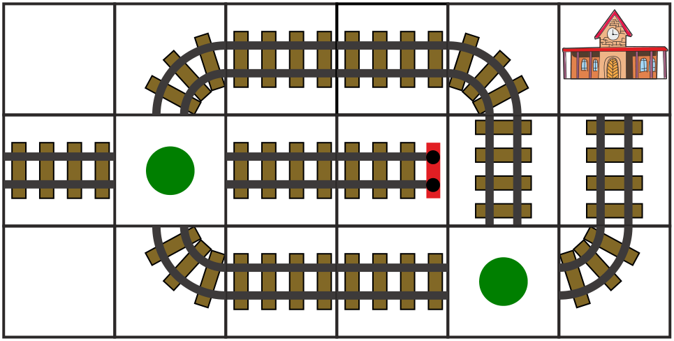

Der Zug soll zum Bahnhof fahren. Dazu müssen auf die grünen Punkte Schienenstücke gelegt werden.

Zur Auswahl stehen diese sechs Schienenstücke (die Zeilen und Spalten des Gleisnetzes werden von oben links gezählt, die Kurven sind nach den Seiten benannt, die sie verbinden):

1. Kurve von unten nach rechts
2. Kurve von unten nach links
3. Kurve von oben nach rechts
4. Kurve von oben nach links
5. Gerade waagerecht
6. Gerade senkrecht

**Welches Schienenstück musst du auf welchen grünen Punkt legen, so dass der Zug zum Bahnhof fahren kann?**
