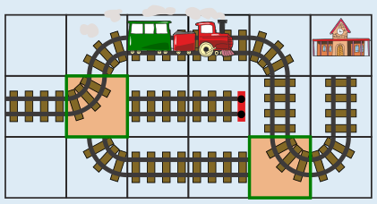
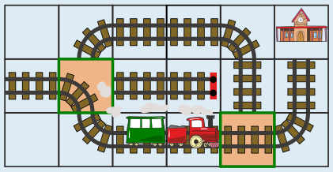

---
answers:
  - { d1: p3, d2: p2 }
  - { d1: p1, d2: p4 }
---
Es gibt zwei Möglichkeiten, Schienenstücke so auf die freien Stellen zu legen, dass der Zug zum Bahnhof fahren kann:

1. Auf den linken Punkt kommt die Kurve von links nach oben, auf den rechten unteren Punkt die Kurve von oben nach rechts.
2. Auf den linken Punkt kommt die Kurve von links nach unten, auf den rechten unteren Punkt die waagerechte Gerade.

 

Bei allen anderen Möglichkeiten entgleist der Zug oder fährt gegen den Prellbock.

## Das ist Informatik!

Wie der Zug in dieser Biberaufgabe genau den Schienen entlang fährt, führt ein Computer genau die Anweisungen eines Programms aus. Der Computer kann nicht erkennen, ob ein Programm einen Fehler enthält – so wie ein Zug nicht erkennen kann, ob Schienen falsch verlegt wurden. Informatikerinnen und Informatiker versuchen deshalb, in Programme „Notbremsen“ einzubauen, mit denen verhindert werden kann, dass Programmfehler Schäden verursachen. Wenn das nicht gelingt, kann der Computer „abstürzen“ und unbenutzbar werden, so wie ein Zug entgleisen kann. Wer ein Programm schreibt, muss also ähnlich sorgfältig sein wie Menschen, die Schienen für Züge verlegen.
