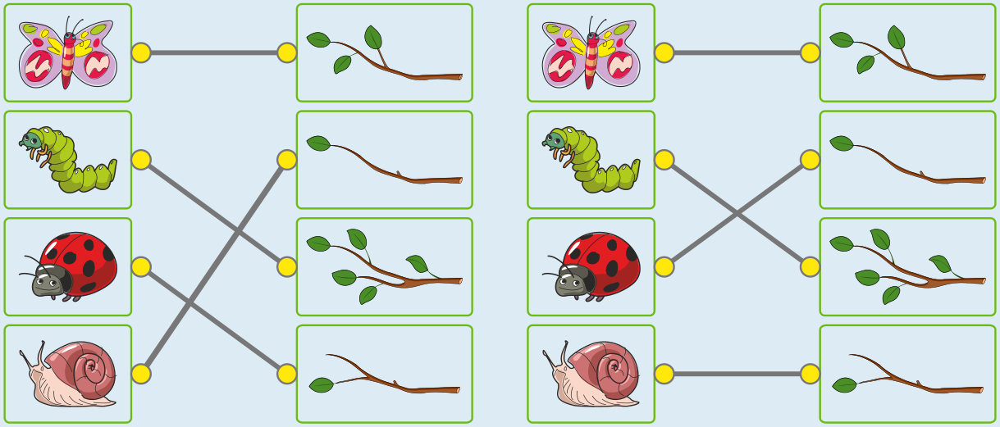

---
answers:
  - { butterfly: b1, caterpillar: b3, ladybug: b2, snail: b4 }
  - { butterfly: b1, caterpillar: b3, ladybug: b4, snail: b2 }
---
Es gibt zwei richtige Antworten:

Der dritte Zweig von oben hat die meisten Blätter, nämlich fünf. Darauf sitzt die Raupe. Der Marienkäfer sitzt auf einem Zweig mit einem Blatt. Das kann der zweite Zweig von oben sein, aber auch der untere Zweig. Es gibt also zwei richtige Lösungen.

Schmetterling und Schnecke sitzen auf den beiden anderen Zweigen. Der eine hat drei Blätter, und der andere hat ein Blatt. Die Schnecke sitzt auf dem zweiten Zweig mit einem Blatt. Dann sitzt der Schmetterling auf dem Zweig mit drei Blättern, also mit mehr Blättern als der Zweig mit der Schnecke.

## Das ist Informatik!

Die richtige Zuordnung der Tiere zu den Zweigen hängt von der Anzahl der Blätter an den Zweigen ab. Eine besondere Rolle spielen Vergleiche zwischen diesen Blätteranzahlen, nämlich „mehr Blätter als“ und „die meisten Blätter“ (was so viel heißt wie „mehr Blätter als alle anderen“). Es wäre wohl einfacher gewesen, diese Biberaufgabe richtig zu beantworten, wenn die Zweige sortiert gewesen wären, nach der Anzahl der Blätter, von oben nach unten. Dann hätte man nämlich die Vergleichsergebnisse sehen können: Der Zweig mit den meisten Blättern wäre oben gewesen, und für einen Zweig oberhalb eines anderen wäre klar gewesen, dass er mehr Blätter hat als der andere.

Beim Umgang mit Daten, insbesondere mit vielen Daten, kann es sehr hilfreich sein, wenn die Daten sortiert sind. In der Kontaktliste auf dem Handy zum Beispiel sind die Daten alphabetisch sortiert; so ist es viel leichter, einen Kontakt zu finden, als wenn die Liste beliebig durcheinander wäre. Computer sind ständig mit dem Sortieren von Daten beschäftigt. Viele Informatikerinnen und Informatiker beschäftigen sich deshalb intensiv damit, wie Computer möglichst schnell auch große Datenmengen sortieren können.
