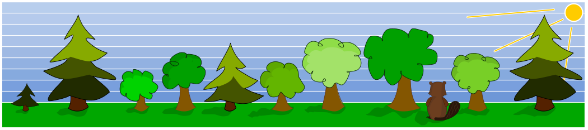

Ein Biber möchte einen Damm bauen. Damit er immer die richtigen Bäume fällt, hat er sich zwei Bedingungen überlegt. Er wird einen Baum genau dann fällen, wenn

- direkt links daneben ein kleinerer Baum steht und
- direkt rechts daneben ein größerer Baum steht.

**Welche Bäume wird der Biber fällen? Wähle die Nummern der Bäume, von links gezählt.**
