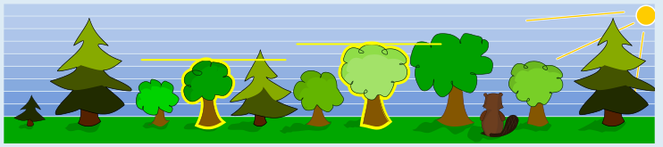

Nur die beiden Bäume an vierter Stelle und siebter Stelle von links erfüllen die vorgegebenen Bedingungen: Der Baum links daneben ist kleiner UND der Baum rechts daneben ist größer.

## Das ist Informatik!

Der Biber in dieser Aufgabe entscheidet für jeden Baum nur anhand seiner beiden Nachbarn, ob er ihn fällt: Links muss ein kleinerer und rechts ein größerer Baum stehen. Er vergleicht also immer nur benachbarte Elemente einer Reihe miteinander. Eine Regel, die nur auf die direkte Umgebung schaut, nennt man lokal. Der Biber erkennt mit seiner Regel eine Stelle, an der die Baumhöhen dreimal hintereinander ansteigen.

Das Vergleichen benachbarter Elemente ist ein Grundbaustein vieler Algorithmen. Beim Sortieren gilt zum Beispiel: Eine Folge ist genau dann aufsteigend sortiert, wenn jedes Paar von Nachbarn richtig herum liegt. Verfahren wie Bubblesort vergleichen deshalb immer wieder benachbarte Elemente und vertauschen sie, wenn sie falsch herum liegen. Eine Prüfung dieser Art ist für einen Computer sehr einfach, weil er die Folge nur einmal von links nach rechts durchlaufen muss.

Auch in der Auswertung von Daten sucht man nach solchen Mustern. Wenn Messwerte, etwa Temperaturen oder Aktienkurse, über mehrere Zeitpunkte hinweg immer weiter steigen, kann ein Programm dies melden. Dazu vergleicht es jeden Wert mit seinem Vorgänger und Nachfolger, genau wie der Biber bei den Bäumen.

*Dieser Abschnitt wurde für den Informatik-Otter ergänzt und steht nicht im Biberheft.*
