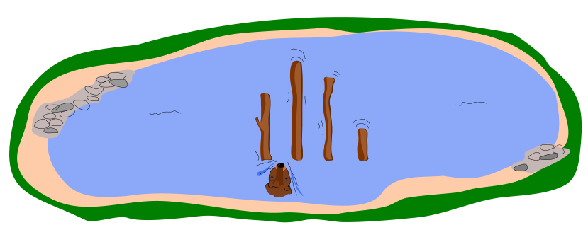

Im See liegen unterschiedlich lange Baumstämme. Hamid soll sie der Länge nach sortieren: von kurz nach lang. Dafür schwimmt er schrittweise an den Stämmen vorbei. Nach jedem Schritt ist er zwischen zwei Stämmen. Er startet zwischen den beiden Stämmen ganz links.

Wenn Hamid zwischen zwei Stämmen ist, vergleicht er deren Längen. Er vertauscht die Stämme, wenn der rechte Stamm kürzer als der linke ist. Wenn er die beiden Stämme vertauscht hat und nicht schon ganz links ist, macht er einen Schritt nach links; wenn er die Stämme nicht vertauscht hat, macht er einen Schritt nach rechts. Dies alles wiederholt er, bis er rechts von den Baumstämmen angekommen ist.

Das Beispiel zeigt, wie Hamid 4 Baumstämme sortiert. Er macht dabei insgesamt 9 Schritte.

Die Anzahl der Schritte hängt davon ab, wie die Stämme am Anfang liegen. Für 4 Stämme muss Hamid mindestens 3 Schritte machen (wenn die Stämme bereits richtig sortiert sind) und höchstens 9 Schritte (wenn die Stämme umgekehrt sortiert sind, von lang nach kurz). Bei 4 Baumstämmen muss Hamid also mit 3 bis 9 Schritten rechnen.

Hamid muss nun 40 Baumstämme sortieren.

**Mit wie vielen Schritten muss er rechnen?**
