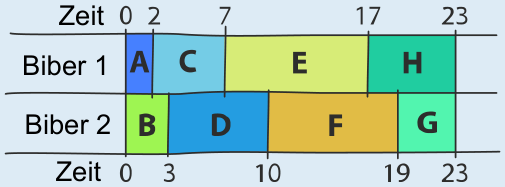

Der Damm ist frühestens nach 23 Stunden fertig. Ein solcher Plan: Biber 1 macht A, C, E, H; Biber 2 macht B, D, F, G.

Im Arbeitsplan aus der Aufgabe hat der erste Biber eine lange Pause (10 Stunden), und der zweite Biber hat insgesamt 8 Stunden lang Leerlauf. Die beiden wären schneller fertig, wenn sie ständig arbeiteten.

Man kommt zu einem insgesamt schnelleren Arbeitsplan, wenn man darauf achtet, dass die beiden größten Aufgaben E(10) und F(9) nicht vom selben Biber ausgeführt werden. Hier ist ein Arbeitsplan, der mit 23 Stunden auskommt. Schneller geht es nicht, denn die beiden Biber arbeiten ohne Pause.

