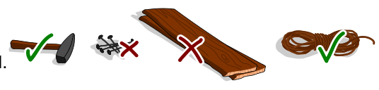
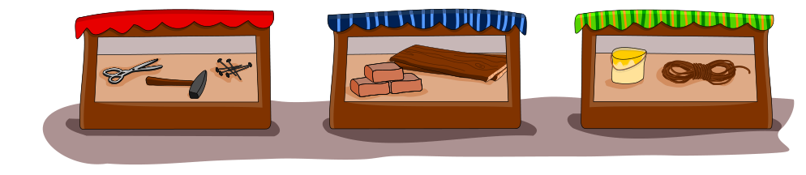

Bella möchte eine Brücke bauen, über einen Bach. Sie braucht: einen Hammer, Nägel, Bretter und ein Seil. Im Keller findet sie einen Hammer und ein Seil. Die anderen Sachen muss sie einkaufen.

Unten siehst du drei Geschäfte, und was sie verkaufen.

**Wo kann Bella die anderen Sachen einkaufen? Wähle alle Geschäfte, die sie dafür braucht.**
