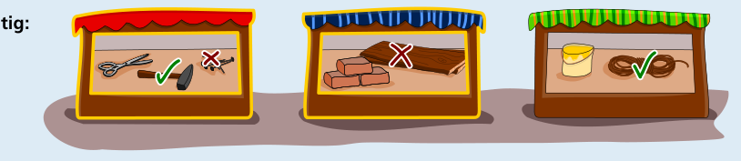

Das Geschäft links verkauft zwei von Bellas Brücken-Bau-Sachen: den Hammer und die Nägel. Den Hammer hat Bella schon, aber sie kann hier die Nägel einkaufen.

Im Geschäft in der Mitte kann Bella die Bretter einkaufen.

Das Geschäft rechts verkauft das Seil. Aber das hat Bella schon.

