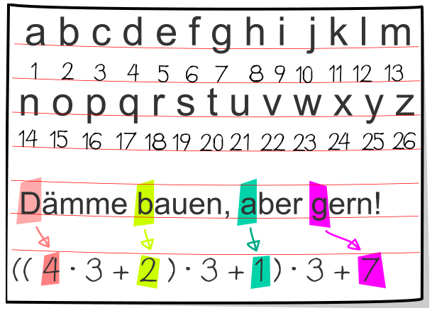

Susi ist mit Tim in der Biber-Bücherei. Sie wollen ein Buch ausleihen: „Dämme bauen, aber gern!“

Tim geht zu Regal 1, greift in Reihe 3, Fach 6 und holt das Buch heraus. Susi ist beeindruckt. Tim erklärt Susi, wie man den Ort eines Buches mit einem Rechenausdruck bestimmt:

Man nimmt von jedem Wort im Titel die Anfangsbuchstaben und bestimmt dessen Position im Alphabet. Nach und nach werden die Positionen addiert; aber vor jedem Addieren wird der bisher erreichte Wert mit 3 multipliziert.

Für das gewünschte Buch ergibt der Ausdruck 136. Schon ist klar, wo das Buch steht.

Nun stellt Susi für ihre vier Lieblingsbücher die Orts-Bestimmungs-Ausdrücke auf. In genau einem Fall hat sie aber einen Fehler gemacht.

**In welchem?**
