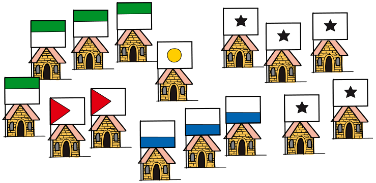

In Beavaria leben fünf einst verfeindete Clans. Alle Häuser mit gleicher Flagge gehören zu einem Clan.

Da die Zeiten lange schon friedlich sind, beschließen die Clans, sich alle nach und nach zu einem Clan zu verbünden. Die Regeln dafür sind:

- Zu jeder Zeit dürfen sich immer nur zwei Clans verbünden.
- In jedem Haus der beiden sich verbündenden Clans wird nacheinander eine Woche lang gefeiert, um den Pakt zu besiegeln. Das Verbünden dauert also so viele Wochen wie beide Clans zusammen Häuser haben.
- Nach dieser Zeit sind die beiden Clans nur noch ein Clan. Dann kann das Verbünden der Clans fortgesetzt werden.

Die Clans beschließen, sich in der kürzestmöglichen Zeit zu einem Clan zu verbünden. Das geht nur, wenn man die Reihenfolge des Verbündens sorgfältig plant.

**Wie viele Wochen dauert es mindestens, bis alle Clans zu einem verbündet sind?**
