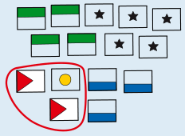
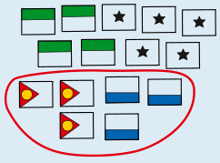
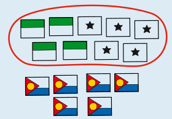
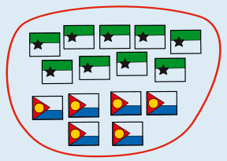
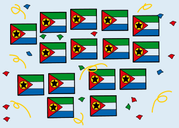

Antwort B ist richtig: 33 Wochen.

Man kann sich überlegen, dass die Häuser der zuerst verbündeten Clans auch an den weiteren Verbündungen beteiligt sind. Die Gesamtdauer wird also dann möglichst kurz, wenn sich in jedem Schritt die beiden Clans mit den aktuell wenigsten Häusern verbünden.

Hier sind die optimalen Verbündungsschritte dargestellt; dabei sind die Clans mit der Anzahl ihrer Häuser bezeichnet.

Zuerst verbünden sich (1) und (2) zu einem Clan (3); dafür brauchen sie drei Wochen.

(3) und (3) verbünden sich in sechs Wochen zu (6).

Nun verbünden sich (4) und (5) in neun Wochen zu (9).

Zuletzt verbünden sich die verbliebenen (6) und (9). Dafür brauchen sie 15 Wochen.

Insgesamt sind alle Clans nach 15 + 9 + 6 + 3 = 33 Wochen zu einem Clan verbündet. Schneller geht es nicht.

Die hier angegebene Reihenfolge ist aber nicht die einzige, die zur schnellsten Verbündung führt. Die Verbündung von (4) und (5) ist unabhängig davon, dass sich (1), (2) und (3) nacheinander verbünden. Diese beiden Teil-Verbündungen können deshalb vertauscht werden, ohne dass es insgesamt länger dauert.

## Das ist Informatik!

Die Clans von Beavaria wollen sich so verbünden, dass die Feiern möglichst wenig Zeit kosten. Dazu verbünden sich immer die beiden Clans mit den aktuell wenigsten Häusern. Ein Verfahren, das in jedem Schritt die gerade beste Möglichkeit wählt und diese nie zurücknimmt, nennt man gieriges Verfahren (englisch Greedy-Algorithmus). Gieriges Vorgehen führt nicht bei jedem Problem zum besten Ergebnis, bei diesem aber schon. Die Begründung steht in der Lösung: Häuser aus früh verbündeten Clans müssen bei jedem weiteren Zusammenschluss mitfeiern, deshalb sollen die kleinen Clans zuerst zusammengehen.

Dasselbe Verfahren steckt im Huffman-Code, einem Verfahren zur Kompression von Daten. Dabei werden Zeichen unterschiedlich lang kodiert: Häufige Zeichen bekommen kurze Codewörter, seltene lange. Für den Aufbau des Codes werden wie bei den Clans immer die beiden Einträge mit der kleinsten Häufigkeit zusammengefasst, bis nur noch einer übrig bleibt. Der Huffman-Code gilt als optimal unter den Codes, die jedes Zeichen einzeln kodieren. Er ist zum Beispiel Teil von Kompressionsverfahren wie ZIP und JPEG.

Eine verwandte Anwendung ist das Mischen sortierter Listen, etwa beim Sortieren sehr großer Dateien. Auch hier ist es am günstigsten, zuerst die kleinen Listen zu mischen und die größten zuletzt. Die Kosten entsprechen dann der Summe aller Zwischenergebnisse, so wie die Wochen der Feiern in der Aufgabe.

*Dieser Abschnitt wurde für den Informatik-Otter ergänzt und steht nicht im Biberheft.*
