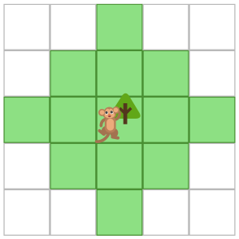
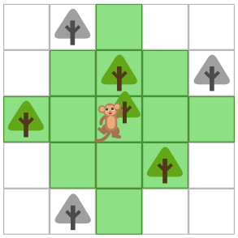

Der Affe Koko kann von einem Baum soweit springen, wie es der grüne Bereich zeigt.

Ein Beispiel: Mit einem Sprung erreicht Koko die farbigen Bäume, die grauen aber nicht.

Es gibt Gruppen von Bäumen, zwischen denen sich Koko mit mehreren Sprüngen beliebig bewegen kann, ohne jemals den Boden zu berühren. Im Beispiel bilden die farbigen Bäume und die beiden grauen Bäume oben eine solche „Sprunggruppe“; der graue Baum unten gehört nicht dazu.

Unten siehst du Kokos Wald.

**Markiere darin alle Bäume der größten Sprunggruppe!**
