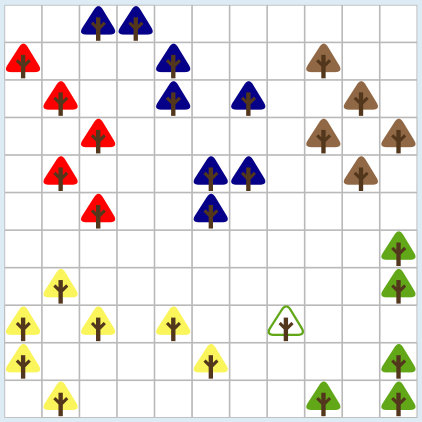

Im Bild haben zwei Bäume dieselbe Farbe, wenn Koko vom einen zum anderen gelangen kann, ohne den Boden zu berühren. Alle Bäume einer Farbe bilden also eine Sprunggruppe. Die acht blauen Bäume bilden die größte Sprunggruppe.

## Das ist Informatik!

Kokos Wald lässt sich als Graph darstellen. Jeder Baum ist ein Knoten, und zwei Bäume werden durch eine Kante verbunden, wenn Koko von einem zum anderen springen kann. Die „Sprunggruppen“ aus der Aufgabe heißen in der Graphentheorie Zusammenhangskomponenten: Das sind Gruppen von Knoten, die durch Wege miteinander verbunden sind, aber keine Verbindung zu den Knoten außerhalb haben. Die größte Sprunggruppe ist die größte Zusammenhangskomponente.

Um sie zu finden, geht man von einem Baum aus und markiert alle Bäume, die man von dort erreicht, entweder zuerst die nächsten Nachbarn (Breitensuche) oder immer erst so weit wie möglich in eine Richtung (Tiefensuche). Dann beginnt man bei einem noch nicht markierten Baum von vorn, bis alle Bäume einer Gruppe zugeordnet sind. Ein Computer macht das für sehr große Graphen in kurzer Zeit.

Solche Fragen stellen sich in vielen Anwendungen. Man kann prüfen, ob in einem Rechnernetz alle Geräte miteinander verbunden sind oder ob es voneinander getrennte Teilnetze gibt. In sozialen Netzwerken werden Gruppen von Personen gesucht, die über Freundschaften zusammenhängen. In der Bildverarbeitung markiert man auf ähnliche Weise zusammenhängende Flächen gleicher Farbe, zum Beispiel beim Füllwerkzeug eines Malprogramms.

*Dieser Abschnitt wurde für den Informatik-Otter ergänzt und steht nicht im Biberheft.*
