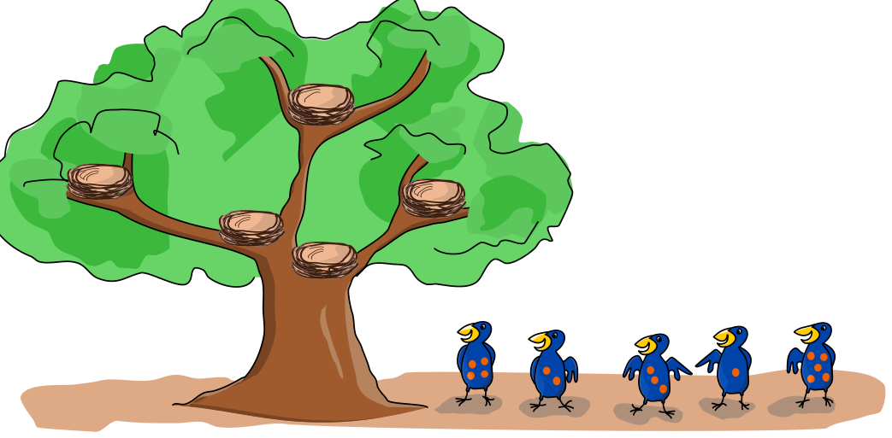

Dottis sind Vögel mit Punkten. Neben einem Baum stehen fünf Dottis. Einer nach dem anderen – von links nach rechts – klettern sie in den Baum und ziehen in die leeren Nester. Der mit den vier Punkten ist der erste. Jeder Dotti geht so vor:

Er beginnt unten am Baum. Er führt solange die folgenden Schritte aus, bis er ein leeres Nest gefunden hat:

1. Er klettert hoch, bis er ein Nest findet.
2. Wenn das Nest leer ist, bleibt er in diesem Nest, fertig.
3. Wenn das Nest schon besetzt ist, klettert er weiter: Wenn der Dotti im Nest
   - mehr Punkte hat, klettert er nach links.
   - gleich viele oder weniger Punkte hat, klettert er nach rechts.

**In welche Nester klettern die Dottis?**
