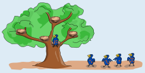
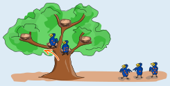
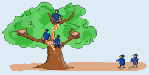
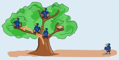
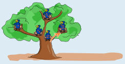

Der erste Dotti, der mit 4 Punkten, bleibt gleich im untersten Nest.

Der zweite Dotti hat 2 Punkte. Im untersten Nest sitzt der erste Dotti mit 4 Punkten. Weil 4 mehr als 2 ist, klettert der zweite Dotti nach links weiter und bleibt im nächsten leeren Nest.

Der dritte Dotti hat 3 Punkte. Weil 4 mehr als 3 ist, klettert der dritte Dotti am untersten Nest nach links. Im nächsten Nest ist der zweite Dotti mit 2 Punkten. Weil 2 weniger als 3 ist, klettert der dritte Dotti weiter nach rechts und bleibt im höchsten Nest.

Der vierte Dotti hat einen Punkt. Am untersten Nest klettert er nach links, und auch am nächsten Nest – denn sowohl 4 als auch 2 sind mehr als 1. Er bleibt schließlich in dem leeren Nest ganz links.

Der letzte Dotti hat fünf Punkte. Er muss beim untersten Nest nach rechts klettern und bleibt dann in dem leeren Nest ganz rechts.

