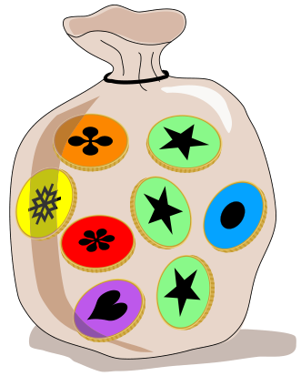

In einem Spiel gibt es vier Arten von Münzen. Hier siehst du die vier Arten, mit beiden Seiten.

Emil hat einige Münzen in eine Tüte getan:

Nun schüttelt Emil seine Tüte. Manche Münzen drehen sich. Emil erkennt seine Tüte trotzdem wieder.

**Welche ist Emils Tüte?**
