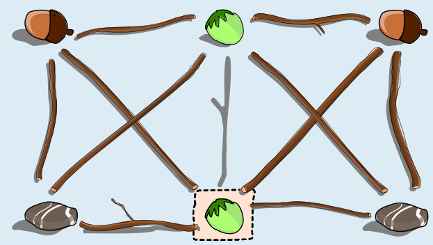

Der Ast in der Mitte zwischen der Haselnuss oben und der Stelle der Erdbeere muss entfernt werden, und an die Stelle der Erdbeere gehört eine Haselnuss.

Wenn man die Erdbeere durch eine Haselnuss ersetzt, verletzt einzig der Ast in der Mitte Anjas Regel: Er liegt zwischen zwei gleichen Sachen, nämlich zwei Haselnüssen. Deshalb muss dieser Ast entfernt werden.

Bei den beiden anderen möglichen Ersetzungen muss man mehr als einen Ast entfernen:

- Wird die Erdbeere durch eine Eichel ersetzt, muss man die Äste zwischen der neuen Eichel und den beiden Eicheln links und rechts oben entfernen.
- Wird die Erdbeere durch einen Stein ersetzt, muss man die Äste zwischen dem neuen Stein und den beiden Steinen links und rechts unten entfernen.

## Das ist Informatik!

Anjas Kunstwerk besteht aus Dingen, die durch Äste verbunden sind, also aus Knoten und Kanten, und es gilt eine Regel: Zwei verbundene Dinge dürfen nicht von der gleichen Art sein. Wenn man jeder Art eine Farbe zuordnet, ist das dasselbe wie in einer Färbung eines Graphen, bei der benachbarte Knoten verschiedene Farben haben müssen. Die Erdbeere ist dabei eine Farbe, die nur einmal vorkommt.

Die Aufgabe ist eine Art Reparatur: Wenn man einen Knoten umfärbt, können nur die Kanten, die an diesem Knoten hängen, die Regel verletzen. Man muss also nur diese Kanten prüfen und für jede mögliche neue Art zählen, wie viele Kanten zu Konflikten führen. So kommt man zur Lösung: Bei der Haselnuss gibt es nur einen Konflikt, bei den anderen beiden Arten zwei. Die Methode, nur die Umgebung einer Änderung zu überprüfen, spart viel Arbeit, weil nicht das ganze Kunstwerk neu untersucht werden muss.

Färbungsprobleme dieser Art kommen in der Praxis häufig vor. Bei der Planung von Prüfungen sind die Knoten Kurse und die Kanten verbinden Kurse mit gemeinsamen Teilnehmenden; verbundene Kurse dürfen nicht zur selben Zeit stattfinden, die Farben sind die Zeitfenster. Ähnlich werden Frequenzen an Funkmasten verteilt, damit benachbarte Masten sich nicht stören. Wenn sich etwas ändert, repariert man eine bestehende Lösung oft schrittweise, anstatt von vorn zu beginnen.

*Dieser Abschnitt wurde für den Informatik-Otter ergänzt und steht nicht im Biberheft.*
