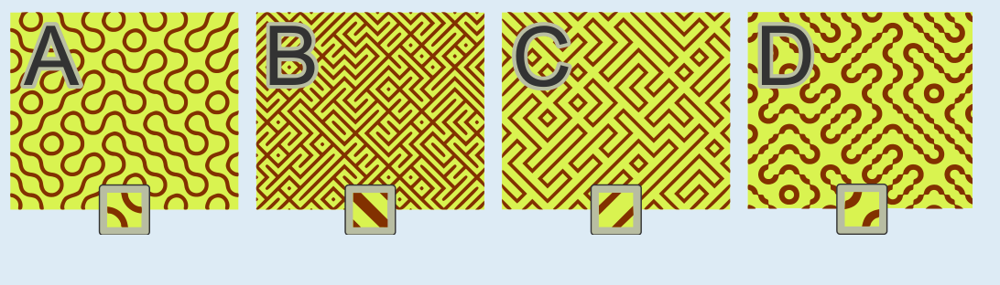

Boden 1 (A) gehört zu Muster 3, Boden 2 (B) zu Muster 4, Boden 3 (C) zu Muster 1 und Boden 4 (D) zu Muster 2.

Das Muster 2 (zwei unterschiedlich große Viertelkreise) ist eine Ausnahme unter den vier Fliesenmustern in dieser Biberaufgabe: Seine vier Seiten sind nicht symmetrisch (zur Mittelachse der Seite) und nicht alle gleich. Wenn daraus ein Boden gelegt wird, schließen die Linien der einzelnen Muster deshalb nicht genau aneinander an. Das ist nur bei Boden 4 (D) der Fall, dem dieses Muster zuzuordnen ist.

Das Muster 4 hat dickere Striche als Muster 1 und kann deshalb dem Boden 2 (B) zugeordnet werden. Für die runden Formen von Muster 3 verbleibt nur Boden 1 (A), und aus den geraden Formen von Muster 1 kann auf Boden 3 (C) geschlossen werden.

## Das ist Informatik!

Wer einen Boden mit gleichen Fliesen auslegt, wiederholt ein kleines Muster immer wieder. In dieser Biberaufgabe musst du aus dem großen Bild auf die kleine Einheit schließen, und umgekehrt: Wenn du die Fliese kennst, kannst du vorhersagen, wie der ganze Boden aussieht. Dafür muss man auf die Ränder der Fliesen achten. Linien, die an einer Kante enden, müssen an der nächsten Fliese genau dort weitergehen. Deshalb passt eine Fliese mit unsymmetrischen Seiten nur dann zu sich selbst, wenn man sie in der richtigen Lage nebeneinanderlegt.

In der Computergrafik nutzt man dieses Prinzip ständig. Ein kleines Bild, eine Textur, wird wie eine Fliese beliebig oft nebeneinandergelegt, um große Flächen zu füllen: Der Boden in einem Computerspiel besteht oft aus wenigen Bildern, die sich wiederholen, und auch Hintergrundmuster von Webseiten funktionieren so. Das spart Speicherplatz, denn man muss nur die kleine Einheit speichern und nicht die ganze Fläche. Damit man keine sichtbaren Nähte sieht, müssen die Ränder der Textur zusammenpassen, genau wie bei den Fliesen.

Die Frage, wie man Flächen mit Fliesen auslegen kann, deren Kanten bestimmte Bedingungen erfüllen müssen, untersucht auch die Theoretische Informatik. Sie beschäftigt sich zum Beispiel mit sogenannten Wang-Kacheln, deren Kanten Farben tragen und nur an gleichfarbige Kanten anschließen dürfen. Mit solchen Kacheln lassen sich sehr abwechslungsreiche Muster erzeugen, ohne dass sich offensichtlich etwas wiederholt.

*Dieser Abschnitt wurde für den Informatik-Otter ergänzt und steht nicht im Biberheft.*
