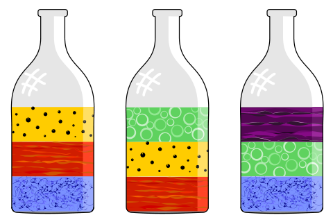

Maria experimentiert mit fünf farbigen Flüssigkeiten. Die Flüssigkeiten haben alle eine andere Dichte und ordnen sich in Schichten an. In drei Flaschen gibt Maria nun jeweils drei Flüssigkeiten – immer gleich viel. Am Ende sind die Flüssigkeiten so angeordnet:

Nun gibt Maria alle fünf Flüssigkeiten in eine Flasche.

**Bringe alle Flüssigkeiten in die Reihenfolge, in der sie am Ende in der Flasche angeordnet sind – von oben nach unten!**
