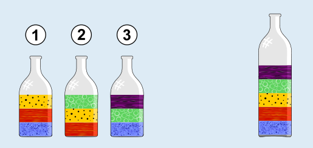

Von oben nach unten liegen die Flüssigkeiten so in der großen Flasche: violett, grün, gelb, rot, blau.

Zunächst kann man sich überlegen: Die Flüssigkeit, die ganz unten in die große Flasche gehört, darf in keiner der drei kleinen Flaschen über einer anderen Flüssigkeit sein.

Nun kann man die Anordnung so herstellen: Schritt für Schritt bestimmt man die Flüssigkeit, die in keiner der drei kleinen Flaschen über einer anderen ist, gibt sie an die unterste freie Stelle in der großen Flasche und entfernt sie dann in Gedanken aus den drei kleinen Flaschen. Im ersten Schritt ist die blaue Flüssigkeit an der Reihe: Sie ist in Flasche 1 und 3 ganz unten und ist in keiner auf einer anderen Flüssigkeitsschicht. Sie kommt ganz unten in die große Flasche und wird danach nicht mehr beachtet. Damit ist im zweiten Schritt die rote Flüssigkeit die einzige, die nicht über einer anderen Flüssigkeit ist, kommt also als nächstes in die große Flasche, direkt über die blaue Flüssigkeit. In den verbleibenden Schritten kommen auf die gleiche Weise nacheinander die gelbe, die grüne und zum Schluss die violette Flüssigkeit in die große Flasche.
