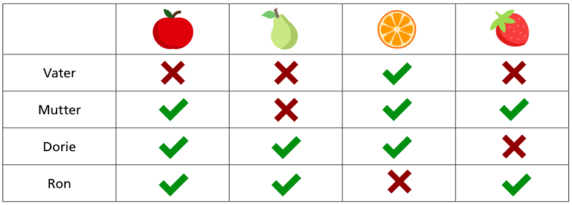

Vater, Mutter, Dorie und Ron Biber packen abends ihre vier Frühstücksboxen. In jede Box kommt eine andere Frucht, und dann werden die Boxen gestapelt. Morgens sind die Bibers noch sehr müde: Wer den Bau verlässt, nimmt einfach die oberste Box vom Stapel, ohne hinzusehen.

Die Biber wissen nicht genau, in welcher Reihenfolge sie morgens den Bau verlassen. Aber Mutter geht immer vor Dorie, und Vater geht immer als Letzter. Die Biber wünschen sich: Die Früchte sollen so in den Boxenstapel, dass in jedem Fall jeder eine Frucht bekommt, die er mag. Die Tabelle zeigt, welche Früchte jeder Biber mag.

**Bringe die Früchte in die gewünschte Reihenfolge im Boxenstapel, von der obersten bis zur untersten Box.**
