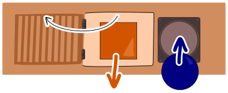

Bastian bekommt zum Geburtstag eine Kiste mit 15 Türen. Hinter der mittleren Tür ist ein weiteres Geschenk. Hinter den anderen Türen sind Bausteine. Zu jeder Tür gehört ein Loch, rechts neben der Tür. Bastian kann eine Tür öffnen, indem er in das Loch einen Baustein gleicher Form einwirft – wie einen Schlüssel.

Zu Beginn hat Bastian einen runden (dunkelblauen) Baustein.

Er will höchstens fünf Türen öffnen, um das Geschenk zu erreichen.

**Welche Tür muss Bastian dafür zuerst öffnen?**
