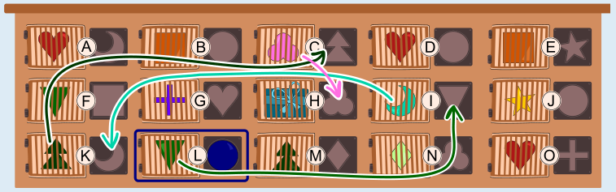

Bastian muss zuerst die Tür L öffnen (die zweite Tür von links in der untersten Reihe). Die Pfeile zeigen, wie Bastian das Geschenk erreicht, indem er genau fünf Türen öffnet. Im Bild sind die Türen mit Buchstaben markiert.

Kann er das Geschenk auch über weniger als fünf Türen erreichen? Der kürzeste Weg zum Geschenk lässt sich mit einer „Rückwärtssuche“ finden. Man beginnt bei der Tür mit dem Geschenk; um die zu öffnen, benötigt man den Baustein hinter Tür C (Kleeblatt). Um diese zu öffnen, benötigt man den Baustein „Tanne“, der hinter den Türen K und M zu finden ist. Um Tür M zu öffnen, würde man den Baustein hinter Tür N benötigen, den man nur mit dem Baustein hinter Tür C erreichen kann – doch der ist bereits verbraucht. Also muss man Tür K mit dem Baustein hinter Tür I öffnen. Tür I kann man mit dem Baustein „Dreieck“ öffnen, der hinter den Türen F und L zu finden ist. Wir wählen Tür L, weil man die mit dem runden Baustein öffnen kann, den Bastian bereits hat. Damit haben wir den Weg gefunden, den man auch so darstellen kann:

Da wir bei der Rückwärtssuche keinen Umweg gemacht haben, gibt es keinen kürzeren Weg. Außerdem ist dies der einzige Weg mit höchstens fünf Türen.

## Das ist Informatik!

Bastian öffnet Türen, um Bausteine zu bekommen, mit denen er weitere Türen öffnen kann. Jede Tür hängt damit von einem Baustein ab, der hinter anderen Türen liegt. Aus diesen Abhängigkeiten lässt sich ein Graph zeichnen, in dem jede Kante sagt: Um diese Tür zu öffnen, brauche ich jenen Baustein. Die Frage ist dann, ob es in diesem Graphen einen Weg vom Anfang zum Ziel gibt und wie lang der kürzeste Weg ist.

Die Lösung geht den Weg rückwärts: Man beginnt beim Ziel und fragt jeweils, was man dafür braucht. Das ist oft klüger als das Vorwärtsprobieren, denn vom Start aus verzweigen sich die Möglichkeiten schnell, vom Ziel aus sind es manchmal viel weniger. Bei einem Rückwärtsvorgehen muss man trotzdem aufpassen: Ein Baustein wird beim Öffnen verbraucht und steht dann nicht mehr zur Verfügung. In der Informatik nennt man das Suche im Zustandsraum, und die Rückwärtssuche trägt den Fachbegriff Backward Chaining.

Rückwärtsschließen wird in der Praxis oft verwendet, etwa in Programmen der Künstlichen Intelligenz, die aus Regeln ein Ziel ableiten, oder in Programmiersprachen wie Prolog. Auch Programme zur Installation von Software gehen ähnlich vor: Sie fragen, was für ein gewünschtes Programm alles installiert sein muss, und prüfen die Abhängigkeiten Schritt für Schritt.

*Dieser Abschnitt wurde für den Informatik-Otter ergänzt und steht nicht im Biberheft.*
