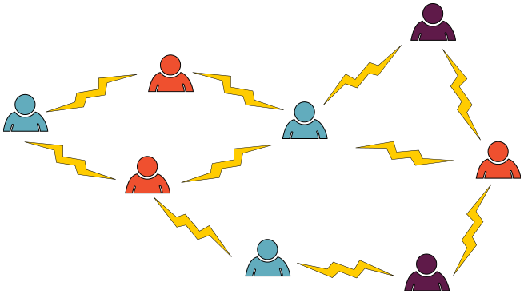

Für ein Projekt sollst du acht Personen in Gruppen aufteilen. Ein Blitz zwischen zwei Personen zeigt: Diese beiden wollen nicht zusammenarbeiten. Zwischen zwei Personen derselben Gruppe darf also kein Blitz sein. Damit ist eine Aufteilung in drei Gruppen möglich: rot, blau und violett.

Nun willst du die Personen in zwei Gruppen aufteilen. Das ist möglich, wenn du die richtigen beiden Personen zur Zusammenarbeit überzeugst – also den richtigen Blitz entfernst.

**Entferne den richtigen Blitz! Tippe ihn im Bild an.**
