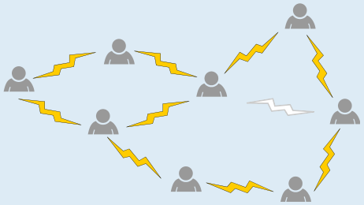
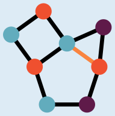
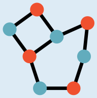
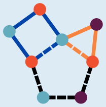

Zu entfernen ist der Blitz zwischen der Person in der Mitte und der Person rechts davon.

Die Ausgangssituation, einschließlich der Einteilung in drei Gruppen, stellen wir nun noch abstrakter dar: Die Personen werden durch Kreise, die Blitze durch Linien und die Einteilung in Gruppen durch die Färbung der Kreise dargestellt.

| Wenn der Blitz entfernt wird, der durch die orange gefärbte Linie dargestellt wird, … | … lassen sich die Personen so in zwei Gruppen einteilen, dass es keine Linie zwischen zwei Personen derselben Gruppe gibt: |
|---|---|
|  |  |

Ist das der einzige Blitz, dessen Entfernung eine Einteilung in zwei Gruppen ermöglicht? Um diese Frage zu beantworten, sehen wir uns die Ausgangssituation genauer an.

Deren Darstellung enthält drei Teile: ein „Viereck“ (blaue Linien), ein „Dreieck“ (orange Linien) und ein „Fünfeck“ (gestrichelte Linien). Für jedes dieser Teile denken wir über die Einfärbung der Kreise nach:

Die Kreise im Viereck können mit zwei Farben eingefärbt werden, wie im Bild zu sehen. Im Dreieck führen von jedem Kreis aus Linien zu zwei anderen Kreisen; deshalb werden für das Dreieck drei Farben benötigt.

Auch für das Fünfeck benötigen wir drei Farben: Wenn wir das Fünfeck im Kreis durchlaufen und dabei nacheinander die Kreise einfärben, könnten wir zunächst zwischen zwei Farben abwechseln. Der letzte Kreis bekäme dann aber dieselbe Farbe wie der erste. Weil das nicht erlaubt ist, benötigen wir für ihn eine dritte Farbe. Die Anzahl der Kreise im Fünfeck ist eben ungerade, wie schon beim Dreieck.

Um mit zwei Farben auszukommen (und die Personen entsprechend in zwei Gruppen einteilen zu können), müssen wir eine Linie so entfernen, dass Fünfeck und Dreieck „verschwinden“. Das geht nur, wenn wir die einzige gemeinsame Linie von Dreieck und Fünfeck entfernen – siehe oben.

## Das ist Informatik!

Die Personen und die Blitze bilden einen Graphen: Jede Person ist ein Knoten, jeder Blitz eine Kante. Die Gruppenaufteilung ist eine Färbung der Knoten, bei der keine Kante zwei gleichfarbige Knoten verbindet. Die Aufgabe fragt, ob zwei Farben genügen und was man ändern muss, damit es klappt.

Dass für das Fünfeck zwei Farben nicht reichen, gilt allgemein: Ein Graph lässt sich genau dann mit zwei Farben färben, wenn er keinen Kreis mit einer ungeraden Anzahl von Knoten enthält. Entlang eines solchen Kreises müssten sich die Farben abwechseln, und der letzte Knoten würde dieselbe Farbe wie der erste bekommen. Ob ein Graph mit zwei Farben färbbar ist, kann ein Computer sehr schnell prüfen: Er färbt einen Knoten, gibt seinen Nachbarn die andere Farbe und so weiter, bis er einen Widerspruch findet oder fertig ist. Für drei Farben ist die Frage dagegen schon schwer. Für diese Frage ist kein Verfahren bekannt, das bei sehr großen Graphen stets schnell eine Antwort liefert.

Man nutzt solche Konfliktgraphen immer, wenn Dinge in Gruppen eingeteilt werden sollen, ohne dass Konflikte entstehen. Bei Klausurplänen sind die Knoten die Prüfungen und die Kanten verbinden Prüfungen mit gemeinsamen Teilnehmenden. Die Farben stehen für die Termine. Möglichst wenige Farben bedeuten möglichst wenige Termine.

*Dieser Abschnitt wurde für den Informatik-Otter ergänzt und steht nicht im Biberheft.*
