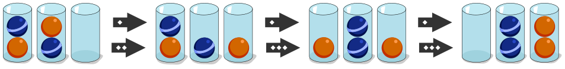

In einem Spiel gibt es Kugeln in zwei Farben; die Kugeln sind in Gläsern. Nun sollst du die Kugeln nach Farbe ordnen: Am Ende sollen alle Kugeln in zwei Gläsern sein, und in einem Glas sollen alle Kugeln die gleiche Farbe haben.

Das Spiel hat drei Regeln:

- Du darfst nur die oberste Kugel eines Glases nehmen.
- Du darfst eine Kugel in ein leeres Glas legen.
- Du darfst eine Kugel in ein Glas legen, wenn dort noch Platz frei ist und die oberste Kugel die gleiche Farbe hat.

Hier ist ein Beispiel, wie du Kugeln nach diesen Regeln ordnen kannst:

**Ordne diese Kugeln!** Glas 1 enthält von oben nach unten: blau, orange, blau. Glas 2 enthält von oben nach unten: orange, blau, orange. Glas 3 ist leer. In jedes Glas passen drei Kugeln.
