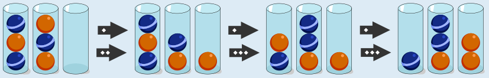
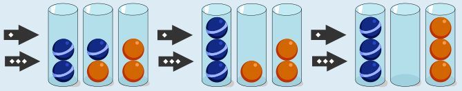

Die Kugeln können zum Beispiel so geordnet werden:

Um diese Kugeln zu ordnen, benötigt man übrigens mindestens 6 Schritte. Es gibt auch noch andere Möglichkeiten, die Kugeln in nur 6 Schritten neu zu ordnen, und noch viele weitere Möglichkeiten, die mehr Schritte benötigen.

## Das ist Informatik!

Die Gläser in diesem Spiel verhalten sich wie Stapel: Man kommt nur an die oberste Kugel heran. Jede Anordnung der Kugeln in den Gläsern ist ein Zustand, und jeder erlaubte Zug führt von einem Zustand zu einem anderen. Alle Zustände zusammen mit den möglichen Zügen bilden einen Graphen, den Zustandsraum. Die Aufgabe, die Kugeln zu ordnen, heißt dann: Finde einen Weg von der Startanordnung zu einer geordneten Anordnung.

Ein Computer kann diesen Weg suchen, indem er systematisch ausprobiert. Er macht einen Zug, prüft, ob das Ziel erreicht ist, und nimmt den Zug zurück, wenn er in eine Sackgasse geraten ist. Dieses Verfahren heißt Backtracking. Wenn er stattdessen alle Anordnungen betrachtet, die nach einem Zug erreichbar sind, dann alle, die nach zwei Zügen erreichbar sind und so weiter, findet er auf jeden Fall eine Lösung mit möglichst wenigen Zügen. So lässt sich auch beweisen, dass es nicht mit weniger als 6 Zügen geht.

Allerdings wächst die Zahl der Zustände mit jedem zusätzlichen Glas und jeder zusätzlichen Kugel sehr schnell an. Man spricht von einer Zustandsexplosion. Deshalb sind für große Probleme dieser Art geschickte Strategien nötig, die möglichst viele Zustände gar nicht erst betrachten. Die Suche im Zustandsraum wird in der Praxis zum Beispiel bei Puzzles, in Schachprogrammen und bei der Planung von Roboterbewegungen benutzt.

*Dieser Abschnitt wurde für den Informatik-Otter ergänzt und steht nicht im Biberheft.*
