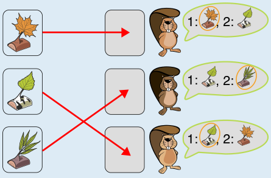

Hier ist die einzige Zuteilung der Geschenke, die beide Bedingungen erfüllt: Kind 1 bekommt das Geschenk mit dem Ahornblatt, Kind 2 das mit dem Weidenblatt und Kind 3 das mit dem Birkenblatt.

Das dritte Geschenk wünscht sich nur der zweite Biber, deshalb muss er es bekommen. Ansonsten würde ein anderer etwas bekommen, das weder das Lieblingsgeschenk noch das zweitliebste ist. Für die anderen beiden Biber ist die Zuteilung dann klar: Jeder kann sein Lieblingsgeschenk bekommen.

## Das ist Informatik!

Die Kinder und die Geschenke sind zwei getrennte Gruppen, und jedes Kind hat eine Verbindung zu den Geschenken, die es mag. Eine solche Darstellung nennt man in der Informatik einen bipartiten Graphen. Gesucht ist eine Zuordnung, bei der jedes Kind genau ein Geschenk bekommt und jedes Geschenk zu genau einem Kind geht. In der Fachsprache ist das ein Matching.

Hier führt eine einfache Überlegung zur Lösung: Ein Geschenk, das sich nur ein Kind wünscht, muss an dieses Kind gehen, sonst passt es für niemanden. Danach bleibt die Zuteilung für die anderen übrig. Ähnlich geht man beim Lösen von Rätseln vor, indem man mit dem Eindeutigen beginnt. Bei größeren Fällen reicht das nicht immer; die Aufgabe „Lieblingsgeschenk b“ zeigt, worauf man dann achten muss.

Solche Zuordnungsprobleme treten überall auf: Studierende und Seminarplätze, Mitarbeitende und Schichten, Kinder und Schulplätze. Computer berechnen solche Zuordnungen, auch wenn es viele Hundert Beteiligte gibt.

*Dieser Abschnitt wurde für den Informatik-Otter ergänzt und steht nicht im Biberheft.*
