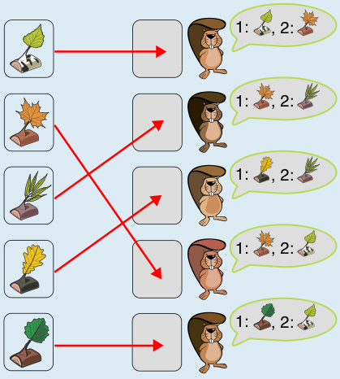

Hier ist die einzige Zuteilung der Geschenke, die beide Bedingungen erfüllt.

Auf diese Weise bekommen vier Biber ihr Lieblingsgeschenk, und ein Biber bekommt das zweitliebste. Damit bekommen möglichst viele Biber ihr Lieblingsgeschenk. Weil zwei Biber dasselbe Lieblingsgeschenk haben, ist es nämlich nicht möglich, dass alle fünf Biber ihr Lieblingsgeschenk bekommen.

Beachte: Wenn du die Zuteilung von oben nach unten vornimmst und das zweite Geschenk dem zweiten Biber zuteilst, dann bekommt der vierte Biber keines seiner bevorzugten Geschenke. In dieser Aufgabe genügt es also nicht, für jeden einzelnen Biber die jeweils beste aktuelle Auswahl zu treffen.

Eine allgemeine Lösungsstrategie ist, dass du zuerst alle Geschenke zuordnest, die Lieblingsgeschenk nur eines Bibers sind. Danach bleiben zwei Biber mit demselben Lieblingsgeschenk übrig. Bei diesen beiden schaust du, welchem das zweitliebste Geschenk zugeteilt werden kann. Dem anderem teilst du sein Lieblingsgeschenk zu.

## Das ist Informatik!

Wie bei „Lieblingsgeschenk a“ geht es um eine Zuordnung zwischen zwei Gruppen, ein Matching in einem bipartiten Graphen. Hier gibt es aber zwei Wünsche pro Kind, und die beiden Kinder mit gleichem Lieblingsgeschenk machen die Sache schwieriger. Gesucht ist die Zuteilung, die für möglichst viele Kinder den ersten Wunsch erfüllt. Das ist ein Optimierungsproblem.

Die Aufgabe zeigt, dass ein gieriges Verfahren, das jedem Kind der Reihe nach gleich das beste noch freie Geschenk gibt, nicht immer zum besten Ergebnis führt. Eine frühe Entscheidung kann später alle anderen Möglichkeiten verbauen. Die Lösung beginnt deshalb mit den eindeutigen Fällen und entscheidet erst danach über die schwierigen. Für den allgemeinen Fall kennt die Informatik Algorithmen, die eine Zuordnung schrittweise verbessern, indem sie bereits zugeteilte Geschenke wieder umverteilen, wenn dadurch ein weiteres Kind zufrieden wird. Berühmt ist die Ungarische Methode für das Zuordnungsproblem, wenn man jeder Zuordnung Kosten gibt und die Summe der Kosten minimieren will. Hier würden zum Beispiel Lieblingsgeschenke 1 und zweite Wünsche 2 kosten.

Anwendungen sind etwa die Vergabe von Plätzen an Schulen oder Hochschulen, wo ebenfalls viele Menschen Wünsche in einer Rangfolge angeben. Auch bei der Zuteilung von Ärztinnen und Ärzten auf Stellen in den USA wird ein solches Verfahren eingesetzt, nämlich der Algorithmus von Gale und Shapley, der zusätzlich die Rangfolge der anderen Seite berücksichtigt.

*Dieser Abschnitt wurde für den Informatik-Otter ergänzt und steht nicht im Biberheft.*
