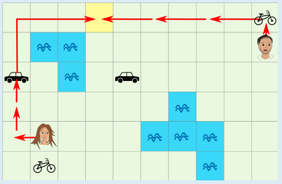

Antwort D ist richtig: 4 Minuten.

Das Bild zeigt eine Möglichkeit, wie die beiden Freunde in 4 Minuten auf dasselbe Feld der Karte gelangen. Das Mädchen könnte auch das Fahrrad nehmen, um zum Auto zu kommen, und würde so ebenfalls in 4 Minuten auf demselben Feld sein.

Aber können sich die beiden auch in weniger als 4 Minuten treffen? Auf dem kürzesten Weg sind die Freunde 11 Schritte voneinander entfernt. Selbst wenn beide die gesamte Strecke mit dem Auto fahren könnten, bräuchten sie dazu mehr als 2 Minuten. Es bleibt also nur die Frage, ob sie sich innerhalb von 3 Minuten treffen können.

In 3 Minuten können sie zu Fuß insgesamt nur 6 Schritte machen. Mit dem Fahrrad könnten sie 12 Schritte machen; aber die beiden Fahrräder sind 13 Schritte voneinander entfernt. Das Mädchen kann in 3 Minuten ein Auto erreichen, es aber dann nicht mehr benutzen. Der Junge kann in 3 Minuten kein Auto erreichen. Insgesamt genügen 3 Minuten also nicht, um sich zu treffen.

## Das ist Informatik!

Die Karte lässt sich als Graph beschreiben: Jedes Feld ist ein Knoten, und Nachbarfelder sind durch Kanten verbunden. Wenn alle Schritte gleich lang dauern, findet die Breitensuche den kürzesten Weg. Sie untersucht zuerst alle Felder, die man in einem Schritt erreicht, dann alle, die man in zwei Schritten erreicht, und so weiter, bis das Ziel erreicht ist.

In dieser Aufgabe dauern die Schritte aber verschieden lang, weil Fahrrad und Auto schneller sind als Gehen. Dann reicht es nicht, die Zahl der Schritte zu zählen, sondern man muss die Zeit betrachten. Außerdem kommt es darauf an, welches Fahrzeug man gerade nutzt. Der Zustand besteht also aus dem Feld und dem Fahrzeug. Algorithmen wie der von Dijkstra berechnen kürzeste Wege in Graphen, deren Kanten unterschiedliche Kosten haben. Die Lösung der Aufgabe geht einen Schritt anders vor: Sie begründet mit einer Abschätzung, dass es in drei Minuten nicht geht, und zeigt einen Weg für vier Minuten. Solche untere Schranken helfen in der Informatik zu beweisen, dass eine Lösung wirklich die beste ist.

Navigationssysteme arbeiten nach diesem Prinzip: Das Straßennetz ist ein Graph, die Kantengewichte sind Fahrzeiten, und bei Routen, die Bus, Bahn und Fahrrad verbinden, kommt wie hier das Verkehrsmittel zum Zustand hinzu. Auch Computerspiele nutzen Wegsuche für die Bewegung ihrer Figuren.

*Dieser Abschnitt wurde für den Informatik-Otter ergänzt und steht nicht im Biberheft.*
