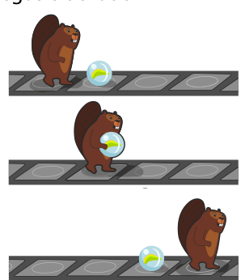
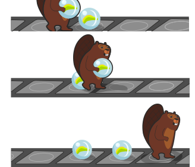
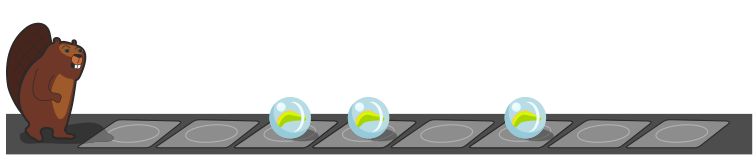

Der Biber spielt gerne mit dem Murmelband. Das Band hat Felder, und darauf können Murmeln liegen, und zwar höchstens eine Murmel pro Feld. Der Biber überquert das Band von links nach rechts. Dabei trägt er manche Murmeln auf andere Felder. Er kann aber immer nur eine Murmel tragen. Wenn der Biber auf ein Feld mit einer Murmel kommt, …

… und keine Murmel trägt, dann hebt er die Murmel auf, trägt sie zum nächsten freien Feld und legt sie dort ab.

… und schon eine Murmel trägt, dann trägt er sie weiter zum nächsten freien Feld und legt sie dort ab.

Heute liegen drei Murmeln so auf dem Murmelband:

**Wie liegen die Murmeln, nachdem der Biber das Murmelband überquert hat?**
